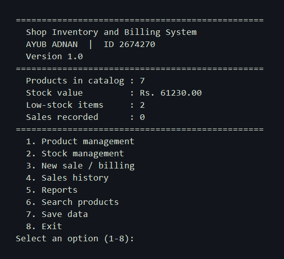
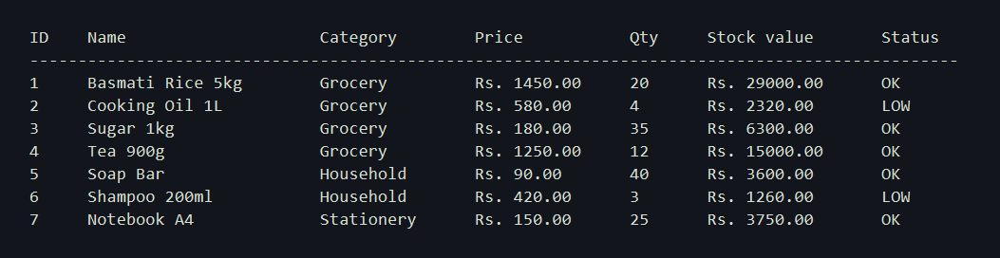
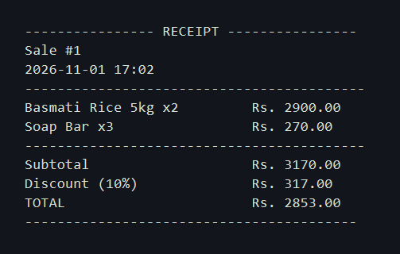
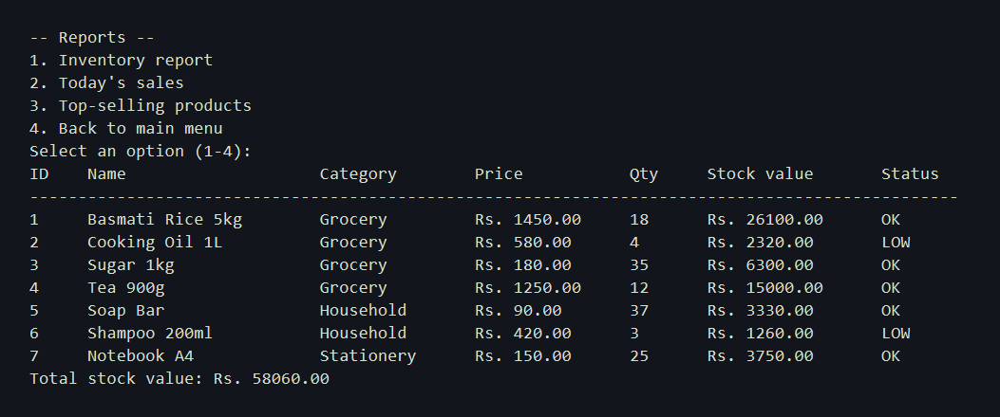

# project-2
Portfolio Project #2 — A C/C++ application developed with the assistance of AI tools, featuring a user interface, preprocessor directives, and error-free compilation. The project demonstrates practical programming concepts and a fully functional user experience.

**Shop Inventory and Billing System** is the programme: a small shop catalog, stock list, and billing desk.

Student: AYUB ADNAN. Student ID: 2674270.

## Official brief (Steps 1–5)

| Step | Brief | This project |
| --- | --- | --- |
| 1 | Choose C or C++ | **C++17**. Classes keep products, receipts, and the shop in separate files. |
| 2 | Purpose: office use, model projections, or a game | **Practical shop use**: catalog, stock, billing, receipts, search, and reports. |
| 3 | Write the programme and use preprocessor directives before compiling | Original source in `src/` and `include/`. Directives live in `include/config.h`. |
| 4 | Compile with an approved compiler | **MinGW GCC** (`build.bat`, or `make`). **Clang** (`make clang`) when clang++ is installed. Both are on the approved list. |
| 5 | Run it, exhaust every option, leave with `return 0` | Numbered menu 1–8. Option **8** saves the data files and returns `0`. |

Peers were optional. This submission is a complete solo programme.

### Step 3 — preprocessor (before the compiler)

`include/config.h` uses `#ifndef` / `#define` / `#endif` (header guard), `#define` for the programme name, student name, student ID, file names, and limits, `#if` / `#error` if the dialect is older than C++17, `#pragma message` at compile time, and `#ifdef` for the Windows console title.

```text
note: #pragma message: Preprocessor: compiling Shop Inventory and Billing System 1.0
```

That line appears while g++ runs. It proves the preprocessor ran first.

### Step 5 — exhaust the menu, then `return 0`

1. Product management (add, edit, delete, list)
2. Stock management
3. New sale / billing
4. Sales history
5. Reports
6. Search products
7. Save data
8. Exit — prints goodbye and returns `0`

Then, in Command Prompt:

```bat
echo %ERRORLEVEL%
```

It should print `0`. In Git Bash the same check is `echo $?`.

## Screenshots

Main menu with the student name, student ID, and every option:



Product list. Cooking Oil and Shampoo are marked LOW:



Receipt for the demo sale. Two items, 10 percent discount, total Rs. 2853.00:



Inventory report after that sale:



## Run

On Windows, from this folder:

```bat
build.bat
shop.exe
```

When `g++` is already on your PATH:

```bash
make
./shop.exe
```

Choose `8` to leave. The programme writes `data/products.txt` and `data/sales.txt` and returns `0`.

Stay in this folder while the programme is running, because it reads and writes the `data` folder here.

Presentation script: `PRESENTATION.md`.
AI tools: `AI_TOOLS.md`.
